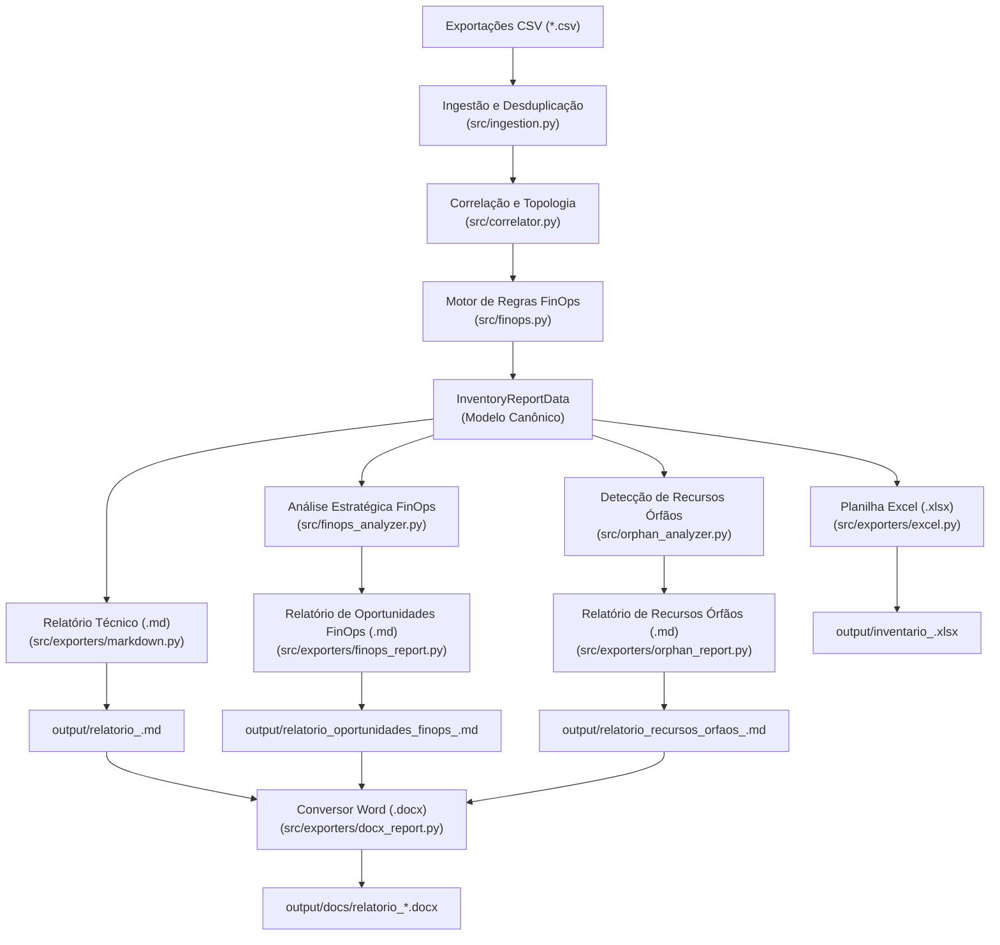

# AWS Resource Mapping & FinOps Pipeline

[](https://www.python.org/)
[]()
[]()
[]()

Pipeline automatizado em Python para auditoria de inventário de infraestrutura AWS, desduplicação canônica de recursos, inferência de topologia de aplicações e geração de relatórios estratégicos de governança e oportunidades de FinOps.

A ferramenta opera em modelo **offline-first**, processando exportações CSV geradas pelo AWS Resource Groups / Tag Editor e consoles de serviços AWS sem necessidade de credenciais ativas de nuvem ou execução remota no momento da análise.

---

## Índice

- [Visão Geral e Propósito](#visão-geral-e-propósito)
- [Principais Funcionalidades](#principais-funcionalidades)
- [Arquitetura e Fluxo do Pipeline](#arquitetura-e-fluxo-do-pipeline)
- [Estrutura do Repositório](#estrutura-do-repositório)
- [Pré-requisitos e Instalação](#pré-requisitos-e-instalação)
- [Como Utilizar](#como-utilizar)
  - [Parâmetros de Linha de Comando](#parâmetros-de-linha-de-comando)
  - [Exemplos de Execução](#exemplos-de-execução)
  - [Formato dos Arquivos de Entrada](#formato-dos-arquivos-de-entrada)
- [Entregáveis Gerados](#entregáveis-gerados)
- [Modelo de Inferência e Cálculo de Valores Monetários](#modelo-de-inferência-e-cálculo-de-valores-monetários)
- [Playbooks Práticos de Investigação FinOps](#playbooks-práticos-de-investigação-finops)
- [Identificação de Recursos Órfãos e Playbooks de Limpeza](#identificação-de-recursos-órfãos-e-playbooks-de-limpeza)
- [Execução de Testes Automatizados](#execução-de-testes-automatizados)
- [Licença e Governança](#licença-e-governança)

---

## Visão Geral e Propósito

Em ambientes AWS em expansão, o desalinhamento entre o que foi provisionado e a documentação técnica gera sobrecustos invisíveis e riscos de governança. Devido ao limite de 1.000 itens por consulta do AWS Tag Editor, equipes frequentemente exportam múltiplos arquivos CSV (globais, regionais ou divididos por serviço).

Este projeto resolve esse desafio de ponta a ponta:
1. **Consolida e desduplica** múltiplos relatórios CSV em uma única base canônica.
2. **Isola o ruído** de componentes de governança corporativa mandatória (AWS Control Tower, GuardDuty, AWS Config, Prisma Cloud, etc.).
3. **Infere automaticamente a topologia** das aplicações agrupando recursos correlatos (ALB ➔ Target Groups ➔ EC2 ➔ RDS ➔ Secrets Manager ➔ S3).
4. **Calcula oportunidades financeiras (FinOps)** com estimativas de economia (USD/mês e USD/ano) e matriz de priorização (Quick Wins vs. Projetos Estruturais).
5. **Fornece Playbooks de Investigação** com comandos prontos do AWS CLI para validar métricas no Amazon CloudWatch e Compute Optimizer antes de qualquer ação destrutiva.

---

## Principais Funcionalidades

### 1. Ingestão e Desduplicação Canônica Inteligente
- Varre dinamicamente todos os arquivos `*.csv` de um diretório de entrada (`--input-dir`).
- Detecta e normaliza automaticamente codificações (`UTF-8`, `UTF-8-SIG`, `ISO-8859-1`) e delimitadores.
- Desduplica registros utilizando o **ARN canônico** como chave primária, com fallback para `Serviço:Tipo:Região:Identificador`.
- Registra a rastreabilidade completa de arquivos de origem (`source_files`) e a data mais recente (`LastReportedAt`).

### 2. Segregação de Governança Corporativa
- Detecta e segrega de forma automatizada componentes de segurança e conformidade da organização (AWS Control Tower, AWS Config, Security Hub, Prisma Cloud, CrowdStrike, IAM básico, SSM documents padrão).
- Separa esses recursos em abas e seções próprias para não sobrecarregar as equipes de sustentação de produto.

### 3. Inferência Topológica e Agrupamento de Aplicações
- Analisa tokens semânticos, prefixos, sufixos e relacionamentos estruturais para agrupar recursos em clusters de aplicação (ex.: *Canais Digitais*, *WordPress / Blog*, *Docker-dev*, *VDO / Promoção Digital*, *Elastic Beanstalk / Legado*).
- Mapeia o encadeamento arquitetural:
  $$\text{Application Load Balancers (ALBs)} \longrightarrow \text{Target Groups} \longrightarrow \text{Instâncias EC2} \longrightarrow \text{RDS / Subnets} \longrightarrow \text{Secrets / S3}$$
- Identifica instâncias e recursos não correlacionados para auditoria detalhada.

### 4. Motor de Regras e Recomendações FinOps
Avalia cada recurso contra heurísticas de custo e ociosidade, atribuindo uma sugestão consultiva fundamentada:
- **`Manter (Governança)`**: Componentes corporativos essenciais de segurança e auditoria.
- **`Manter (Em Operação)`**: Cargas ativas em produção ou desenvolvimento com aplicação mapeada.
- **`Investigar (Possível Órfão / Ocioso)`**: Recursos sem associação ativa (ex.: ALBs com proporção anormal, snapshots manuais residuais, Elastic IPs sem instância).
- **`Investigar (Possível Teste / Temporário)`**: Itens contendo tokens como `teste`, `temp`, `tmp`, `poc`, `demo` ou `lab`.

### 5. Análise Estratégica de Oportunidades FinOps
O módulo analítico dedicado estrutura os achados em três pilares estratégicos:
- **Pilar A (Padrões de Consumo & Agendamento):** Dispersão de recursos em regiões secundárias fora do escopo principal e identificação de cargas 24x7 elegíveis para desligamento programado em horários não úteis (*Instance Scheduler*).
- **Pilar B (Right-sizing & Superdimensionamento):** Diagnóstico de desproporção arquitetural (ex.: excesso de ALBs para poucas instâncias de computação) e oportunidades de redimensionamento de instâncias EC2 e bancos RDS.
- **Pilar C (Redução Direta de Custos):** Liberação de Elastic IPs desassociados, higienização de snapshots manuais antigos e descarte seguro de recursos temporários.

### 6. Detecção de Recursos Órfãos e Higienização de Nuvem
Auditoria aprofundada orientada a SRE, DevOps e Engenharia de Infraestrutura para detecção de resíduos técnicos e ativos desvinculados em 5 domínios críticos:
- **Armazenamento:** Volumes EBS desanexados (`status=available`) e snapshots manuais residuais (EBS e RDS) sem ciclo de expiração.
- **Rede & Conectividade:** Elastic IPs não associados gerando cobrança horária contínua, interfaces de rede (ENIs) soltas e Security Groups manuais sem vínculo.
- **Balanceamento de Carga:** Application Load Balancers (ALBs) ociosos e Target Groups vazios sem instâncias operacionais saudáveis.
- **Cache & Dados In-Memory:** Usuários IAM e ACLs do Amazon ElastiCache e MemoryDB residuais em regiões onde não há clusters ativos.
- **Segurança, Logs & Certificados:** Certificados digitais ACM sem associação e Log Groups do CloudWatch sem retenção de serviços desativados.

Apresenta metodologia clara de status:
- **`[CONFIRMADO ÓRFÃO]`**: Recursos com comprovação conclusiva de ausência de vínculo ou dependência ativa no inventário.
- **`[CANDIDATO A ÓRFÃO]`**: Recursos com forte evidência de ociosidade que requerem validação prévia de telemetria ou estado via playbook antes do descarte.

Cada categoria conta com **Playbooks de Higienização Executáveis (Playbooks 1 a 9)** com passos de validação (`Passo 1: Validação e Inspeção`), recomendações de segurança/backup (*guardrails*) e comandos de descarte seguro (`Passo 2: Remoção Segura`).

---

## Arquitetura e Fluxo do Pipeline



---

## Estrutura do Repositório

```text
resources multicanais-dev/
├── contas/
│   └── multicanais-dev/           # CSVs exportados da conta AWS analisada
├── docs/
│   └── superpowers/
│       ├── plans/                 # Planos de implementação detalhados
│       └── specs/                 # Especificações técnicas e funcionais
├── output/                        # Artefatos gerados pelo pipeline
│   ├── inventario_<conta>.xlsx
│   ├── relatorio_<conta>.md
│   ├── relatorio_oportunidades_finops_<conta>.md
│   ├── relatorio_recursos_orfaos_<conta>.md
│   └── docs/                      # Relatórios formatados para Word (.docx)
│       ├── relatorio_<conta>.docx
│       ├── relatorio_oportunidades_finops_<conta>.docx
│       └── relatorio_recursos_orfaos_<conta>.docx
├── src/
│   ├── __init__.py
│   ├── main.py                    # Entrypoint CLI do pipeline
│   ├── models.py                  # Modelos de dados e Dataclasses
│   ├── ingestion.py               # Leitura, parsing e deduplicação canônica
│   ├── correlator.py              # Extração de tokens, agrupamento e topologia
│   ├── finops.py                  # Heurísticas de classificação FinOps por recurso
│   ├── finops_analyzer.py         # Análise de oportunidades, estimativas e playbooks
│   ├── orphan_analyzer.py         # Auditoria de recursos órfãos nos 5 domínios e playbooks
│   └── exporters/
│       ├── __init__.py
│       ├── excel.py               # Geração do workbook Excel estilizado
│       ├── markdown.py            # Geração do relatório técnico de inventário
│       ├── finops_report.py       # Geração do relatório executivo de FinOps
│       ├── orphan_report.py       # Geração do relatório de recursos órfãos
│       └── docx_report.py         # Conversão e estilização executiva em Word (.docx)
├── tests/                         # Suite de testes unitários e de integração
│   ├── test_ingestion.py
│   ├── test_correlator.py
│   ├── test_finops.py
│   ├── test_finops_analyzer.py
│   ├── test_orphan_analyzer.py
│   ├── test_excel_exporter.py
│   ├── test_markdown_exporter.py
│   ├── test_finops_report_exporter.py
│   ├── test_orphan_report_exporter.py
│   ├── test_docx_exporter.py
│   ├── test_models.py
│   └── test_e2e.py
└── README.md
```

---

## Pré-requisitos e Instalação

### Pré-requisitos
- **Python 3.10 ou superior** (compatível e testado até Python 3.15).
- Gerenciador de pacotes `pip`.

### Instalação

1. Clone ou acesse o diretório do repositório:
   ```bash
   cd "resources multicanais-dev"
   ```

2. (Opcional, porém recomendado) Crie e ative um ambiente virtual:
   ```bash
   # Windows (PowerShell)
   python -m venv .venv
   .\.venv\Scripts\Activate.ps1

   # Linux / macOS
   python3 -m venv .venv
   source .venv/bin/activate
   ```

3. Instale as dependências necessárias:
   ```bash
   pip install openpyxl python-docx pytest
   ```

> [!NOTE]
> O projeto utiliza prioritariamente a biblioteca padrão do Python (`csv`, `re`, `pathlib`, `argparse`, `dataclasses`, `datetime`). As dependências externas para execução do pipeline são o `openpyxl` (geração de planilhas Excel formatadas) e o `python-docx` (geração de documentos Word `.docx`). O `pytest` é utilizado para execução da suite de testes.

---

## Como Utilizar

### Parâmetros de Linha de Comando

A ferramenta é executada via módulo Python através do comando:

```bash
python -m src.main [opções]
```

| Parâmetro | Tipo | Padrão | Descrição |
| :--- | :--- | :--- | :--- |
| `--input-dir` | String | `./` | Caminho do diretório contendo os arquivos CSV exportados da AWS. |
| `--output-dir` | String | `./output` | Diretório onde os relatórios e planilhas gerados serão gravados. |
| `--account` | String | `""` | Identificador ou apelido da conta AWS. Se omitido, é detectado automaticamente a partir da coluna `Conta da AWS` dos CSVs. |

---

### Exemplos de Execução

#### Exemplo 1: Execução Padrão com Diretório de Conta
Processa todos os CSVs da pasta `contas/multicanais-dev` e salva os relatórios na pasta padrão `output/`:

```bash
python -m src.main --input-dir "./contas/multicanais-dev"
```

#### Exemplo 2: Personalizando Diretório de Saída e Nome da Conta
Permite especificar um diretório de saída customizado e forçar a identificação da conta para titulação dos relatórios:

```bash
python -m src.main --input-dir "./contas/multicanais-dev" --output-dir "./output/relatorios-nov" --account "multicanais-dev"
```

#### Exemplo 3: Auditoria em Nova Conta AWS
Para processar outra conta AWS, basta colocar os CSVs exportados em uma nova pasta (ex.: `contas/conta-producao`) e executar:

```bash
python -m src.main --input-dir "./contas/conta-producao" --output-dir "./output" --account "conta-producao"
```

---

### Formato dos Arquivos de Entrada

A ferramenta processa automaticamente qualquer exportação CSV oriunda de:
- **AWS Resource Groups & Tag Editor** (exportações completas ou parciais por região).
- **Consoles de Serviços Específicos** (ex.: listagem de EC2, RDS, ElastiCache, Secrets Manager, CloudFormation, CloudWatch, S3, MemoryDB, ACM).

Colunas padrão reconhecidas automaticamente:
- `Identificador` ou `Identifier`
- `Nome` ou `Name`
- `ARN`
- `Tipo de recurso` ou `Resource type`
- `Região` ou `Region`
- `Conta da AWS` ou `AWS Account`
- `Relatado pela última vez` ou `Last reported at`
- `Tags`

---

## Entregáveis Gerados

Após a execução, o pipeline entrega quatro artefatos complementares no diretório de saída:

| Arquivo | Formato | Público-Alvo | Conteúdo Principal |
| :--- | :--- | :--- | :--- |
| `inventario_<conta>.xlsx` | Planilha Excel | Engenharia & Operações | Pasta de trabalho interativa com formatação visual, filtros automáticos e abas separadas:<br>• **Resumo Executivo** (Métricas consolidadas)<br>• **Aplicações Mapeadas** (Agrupamento por aplicação)<br>• **Inventário Completo** (Todos os recursos com colunas editáveis: *Decisão do Time*, *Responsável*, *Observações*)<br>• **Governança e Segurança** (Isolamento de Control Tower, Prisma, etc.)<br>• **Oportunidades FinOps** (Itens sinalizados para auditoria) |
| `relatorio_<conta>.md` | Markdown | Liderança Técnica & Arquitetura | Relatório técnico com sumário executivo, tabela de topologia por aplicação, distribuição geográfica de recursos e catálogo de cargas de computação. |
| `relatorio_oportunidades_finops_<conta>.md` | Markdown | FinOps, Gestão & Diretoria | Relatório executivo com scorecards de economia estimada (mensal e anual), matriz de priorização (*Quick Wins* vs. *Projetos Estruturais*), detalhamento por pilar e playbooks copiáveis do AWS CLI. |
| `relatorio_recursos_orfaos_<conta>.md` | Markdown | SRE, DevOps & Infraestrutura | Relatório executivo de higienização de nuvem contendo Scorecard de desperdício mensal e anualizado, matriz de esforço x impacto, tabelas de recursos órfãos segregadas pelos 5 domínios e playbooks operacionais executáveis em Bash/AWS CLI (Playbooks 1 a 9). |
| `docs/relatorio_*.docx` | Documento Word (.docx) | Gestão, Chamados & E-mails | Versões formatadas em `.docx` de todos os 3 relatórios executivos e técnicos salvos na subpasta `output/docs/`, com tabelas estilizadas, títulos corporativos e blocos de código prontos para anexar diretamente em tickets do Jira, ServiceNow ou comunicados por e-mail. |

---

## Modelo de Inferência e Cálculo de Valores Monetários

Como a ferramenta opera em modelo **offline-first** (sem conexão direta com o AWS Cost Explorer ou faturamento em tempo de execução), ela utiliza um **motor de inferência paramétrica** calibrado com a tabela pública de preços da AWS e premissas conservadoras de ambientes de desenvolvimento e homologação.

Esse modelo permite que a liderança e os engenheiros visualizem imediatamente a ordem de grandeza do desperdício financeiro e priorizem esforços com base no retorno sobre o investimento (ROI).

### 1. Tabela de Heurísticas e Fórmulas de Economia

| Oportunidade / Recurso | Pilar | Fórmula de Economia Mensal (USD) | Premissas e Justificativa de Precificação |
| :--- | :--- | :--- | :--- |
| **Consolidação de ALBs Excedentes** | Superdimensionamento | `max(0, qtd_albs - 2) × $22.50` | Na AWS, cada Application Load Balancer possui tarifa horária fixa de ~$0.0225/h a $0.025/h (~$20 a $25/mês fixo). O modelo assume redundância base de 2 ALBs compartilhados (roteamento por Host/Path). |
| **Agendamento Noturno 24x7 (Instance Scheduler)** | Padrões de Consumo | `[(qtd_ec2 × $35.00) + (qtd_rds × $55.00)] × 60%` | Considera custo médio mensal de cargas de dev (instâncias EC2 `t3/t4g` a ~$35/mês e instâncias RDS a ~$55/mês em 720h/mês). O desligamento programado em regime comercial (desligamento noturno e aos fins de semana = ~220h/mês) proporciona ~60% de redução nas horas tarifadas. |
| **Right-sizing de Computação EC2** | Superdimensionamento | `qtd_ec2 × $20.00` | Economia média projetada ao realizar o *downsizing* em um degrau de família de instância ou migrar para instâncias baseadas no processador ARM AWS Graviton (`t4g`), que entregam até 20% a 40% de redução de custo com alta performance. |
| **Elastic IPs Desassociados / Ociosos** | Redução de Custos | `qtd_eips × $3.65` | Política oficial da AWS de tarifação para endereços IPv4 públicos e EIPs não associados a instâncias em execução ($0.005/hora × 730 horas/mês ≈ $3.65/mês por IP). |
| **Snapshots Manuais e Retenção Residual** | Redução de Custos | `qtd_snapshots × $5.00` | Custo de armazenamento EBS Snapshot ($0.05/GB-mês na AWS) assumindo volumes médios incrementais de desenvolvimento de ~100 GB retidos sem política automatizada de expiração via AWS Backup. |
| **Dispersão em Regiões Secundárias** | Padrões de Consumo | `qtd_recursos_acionaveis_fora_nucleo × $1.50` | Custo residual unitário ponderado de manutenção de recursos órfãos (endpoints de VPC, pequenos volumes, security groups, logs) em regiões geográficas fora do escopo homologado do projeto. |
| **Recursos Temporários e de Teste** | Redução de Custos | `qtd_recursos_teste × $8.00` | Custo residual médio ponderado por recurso descartável abandonado identificado por convenções de nomenclatura (`teste`, `tmp`, `poc`, `demo`, `lab`). |

### 2. Projeção Anualizada e Totalização

O consolidado financeiro do scorecard executivo é calculado pela soma das oportunidades ativas:

$$\text{Economia Mensal Estimada (USD/mês)} = \sum_{i=1}^{n} \text{Economia Mensal da Oportunidade}_i$$

$$\text{Economia Anualizada Projetada (USD/ano)} = \text{Economia Mensal Estimada} \times 12$$

### 3. Rigor Metodológico: Fatos Conclusivos vs. Hipóteses

O pipeline separa rigorosamente o grau de certeza de cada valor monetário apresentado:
- **`[AÇÃO IMEDIATA]` (Evidência Conclusiva):** Recursos cujo custo fixo independe de telemetria e o inventário comprova a ineficiência (ex.: cobrança fixa de 9 ALBs para apenas 2 instâncias EC2, ou Elastic IPs desassociados).
- **`[NECESSITA ANÁLISE]` (Hipótese de Alto Potencial):** Recursos onde o inventário comprova a existência do custo, mas a viabilidade da ação requer comprovação de métricas de telemetria no CloudWatch (ex.: confirmar que o uso de CPU das EC2 é < 10% ou que conexões ao RDS zeram durante a noite). Para esses, a ferramenta fornece o comando exato do AWS CLI nos playbooks.

---

## Playbooks Práticos de Investigação FinOps

Quando o inventário estático identifica um recurso com oportunidade de custo, mas sem telemetria de consumo em tempo de execução, ele não descarta o item. O relatório executivo classifica o item como `[NECESSITA ANÁLISE]` e inclui um roteiro com comandos do **AWS CLI** prontos para execução imediata.

### Exemplo: Auditoria de Right-sizing de EC2
```bash
aws cloudwatch get-metric-data \
  --region sa-east-1 \
  --metric-data-queries '[{"Id":"m1","MetricStat":{"Metric":{"Namespace":"AWS/EC2","MetricName":"CPUUtilization","Dimensions":[{"Name":"InstanceId","Value":"i-090d9b01ccf2af5ae"}]},"Period":86400,"Stat":"Average"},"ReturnData":true}]' \
  --start-time $(date -u -v-14d +%Y-%m-%dT%H:%M:%SZ) \
  --end-time $(date -u +%Y-%m-%dT%H:%M:%SZ)
```

### Exemplo: Auditoria de Tráfego de Application Load Balancers
```bash
aws cloudwatch get-metric-data \
  --region ca-central-1 \
  --metric-data-queries '[{"Id":"m1","MetricStat":{"Metric":{"Namespace":"AWS/ApplicationELB","MetricName":"RequestCount","Dimensions":[{"Name":"LoadBalancer","Value":"app/Docker-dev/6de4d3f3d608fb4c"}]},"Period":86400,"Stat":"Sum"},"ReturnData":true}]' \
  --start-time $(date -u -v-14d +%Y-%m-%dT%H:%M:%SZ) \
  --end-time $(date -u +%Y-%m-%dT%H:%M:%SZ)
```

---

## Identificação de Recursos Órfãos e Playbooks de Limpeza

Ambientes corporativos e de desenvolvimento sofrem degradação progressiva de governança gerada por testes pontuais, deploys automatizados interrompidos ou exclusão de instâncias sem a remoção em cascata dos componentes dependentes. 

Para resolver essa dor, o pipeline incorpora um motor especializado de auditoria de recursos órfãos (`src/orphan_analyzer.py`) e geração de relatório dedicado (`src/exporters/orphan_report.py`), mapeando resíduos técnicos em 5 domínios arquiteturais e oferecendo um roteiro acionável para higienização segura.

### 1. Os 5 Domínios de Auditoria de Recursos Órfãos

| Domínio | Recursos Cobertos | Problema Identificado e Risco Operacional |
| :--- | :--- | :--- |
| **1. Armazenamento** | • Volumes EBS (`ec2:volume`)<br>• Snapshots Manuais EBS (`ec2:snapshot`)<br>• Snapshots Manuais RDS (`rds:snapshot`) | Volumes EBS desanexados (`status=available`) continuam sendo faturados mês a mês pela AWS na íntegra. Snapshots manuais retidos sem ciclo de vida (LifeCycle) acumulam custos contínuos sem benefício operacional. |
| **2. Rede & Conectividade** | • Elastic IPs (`ec2:elastic-ip`)<br>• Interfaces de Rede ENI (`ec2:network-interface`)<br>• Security Groups (`ec2:security-group`) | A AWS tarifa todo IPv4 público alocado sem instância EC2 ativa vinculada ($0.005/hora). ENIs soltas podem causar exaustão de IPs da subnet e Security Groups não utilizados geram poluição de regras e sprawl. |
| **3. Balanceamento de Carga** | • Application Load Balancers (`elasticloadbalancing:loadbalancer/app`)<br>• Target Groups (`elasticloadbalancing:targetgroup`) | Cada ALB provisionado acarreta cobrança horária fixa (~$22.50/mês). Target Groups sem instâncias saudáveis ou sem listeners ativos apontam roteamento quebrado ou infraestrutura legada abandonada. |
| **4. Cache & Dados In-Memory** | • Usuários MemoryDB / ElastiCache (`elasticache:user`, `memorydb:user`)<br>• Listas de Acesso ACL (`memorydb:acl`, `memorydb:parametergroup`) | Credenciais e controles de acesso remanescentes em regiões geográficas onde não há qualquer cluster de banco em memória ativo, gerando risco de segurança e poluição de governança. |
| **5. Segurança, Logs & Certificados** | • Certificados Digitais ACM (`acm:certificate`)<br>• CloudWatch Log Groups (`logs:log-group`) | Certificados TLS sem distribuição CloudFront ou ALB vinculados podem expirar sem governança. Log Groups sem política de expiração definida (*Never Expire*) acumulam faturamento contínuo de retenção perpétua de dados de serviços desativados. |

### 2. Metodologia de Classificação: Status e Certeza Técnica

O pipeline categoriza cada recurso analisado com base no nível de evidência disponível no inventário estático:

- **`[CONFIRMADO ÓRFÃO]`**: Casos em que a ausência de componentes dependentes comprova o abandono imediato no próprio inventário canônico (ex.: credenciais de banco em memória em regiões sem nenhum cluster provisionado). Ação de higienização recomendada com risco operacional praticamente nulo.
- **`[CANDIDATO A ÓRFÃO]`**: Recursos com forte indício de ociosidade ou desvinculação, mas cujo inventário estático não fornece a telemetria em tempo real (ex.: se o volume EBS está anexado, se o Elastic IP está associado a uma ENI ou se o ALB registrou requisições nos últimos 14 dias). Para esses, o relatório fornece o status como candidato e instrui o comando exato de inspeção antes de qualquer exclusão.

### 3. Tabela Paramétrica de Custos e Fórmulas de Desperdício

Como o inventário opera em modelo *offline-first*, os valores monetários estimados utilizam valores de referência oficiais da AWS para a região primária (`ca-central-1` / `sa-east-1`):

| Categoria / Recurso Auditado | Status Padrão | Custo Unitário Mensal Estimado (USD) | Premissas e Justificativa de Precificação AWS |
| :--- | :--- | :--- | :--- |
| **Elastic IP Não Associado** | `[CANDIDATO A ÓRFÃO]` | **~$3.65 / mês** | Política oficial AWS: tarifação de US$ 0,005/hora por endereço IPv4 público não associado a uma instância em execução (730h × $0.005 ≈ $3.65/mês). |
| **Volume EBS Desanexado** | `[CANDIDATO A ÓRFÃO]` | **~$8.00 / mês** | Volume padrão GP3/GP2 (~100 GB × $0.08/GB-mês). Na AWS, volumes desanexados continuam gerando cobrança integral de capacidade provisionada. |
| **Snapshot Manual RDS** | `[CANDIDATO A ÓRFÃO]` | **~$5.00 / mês** | Retenção de snapshot de banco de dados relacional (~100 GB a ~$0.095/GB-mês deduzida a franquia gratuita de backup). |
| **Snapshot Manual EBS** | `[CANDIDATO A ÓRFÃO]` | **~$2.50 / mês** | Tarifa de armazenamento EBS Snapshot ($0.05/GB-mês) para snapshot médio incremental de desenvolvimento (~50 GB). |
| **Application Load Balancer Ocioso** | `[CANDIDATO A ÓRFÃO]` | **~$22.50 / mês** | Tarifa horária fixa base do ALB ($0.0225/h × 730h + LCU base ≈ $20 a $25/mês) independente de volume de requisições. |
| **CloudWatch Log Group Sem Retenção** | `[CANDIDATO A ÓRFÃO]` | **~$1.50 / mês** | Custo de armazenamento CloudWatch Logs ($0.03/GB-mês) para log groups com ingestão residual acumulada sem política de ciclo de vida. |
| **Target Group Vazio / Sem Alvos** | `[CANDIDATO A ÓRFÃO]` | **$0.00** | Sem custo financeiro direto; foco em higienização arquitetural e eliminação de rotas órfãs. |
| **Interface de Rede (ENI) Solta** | `[CANDIDATO A ÓRFÃO]` | **$0.00** | Sem custo direto; foco em segurança, liberação de pools de subnets e prevenção de IP leaks. |
| **Security Group Não Utilizado** | `[CANDIDATO A ÓRFÃO]` | **$0.00** | Sem custo direto; foco em não atingir o limite de 2.500 security groups por VPC e higiene de regras. |
| **Certificado Digital ACM Sem Uso** | `[CANDIDATO A ÓRFÃO]` | **$0.00** | Certificados públicos emitidos pela AWS são gratuitos; foco em governança de domínios e expiração. |
| **Usuários / ACLs de Cache Órfãos** | `[CONFIRMADO ÓRFÃO]` | **$0.00** | Sem cobrança por credencial; foco em segurança cibernética e descarte de credenciais sem cluster ativo. |

### 4. Playbooks Operacionais de Limpeza Segura (Playbooks 1 a 9)

O relatório executivo de recursos órfãos gera automaticamente playbooks executáveis estruturados no padrão de segurança em duas etapas: **Passo 1 (Validação e Inspeção)** e **Passo 2 (Remoção Segura com Guardrail)**.

| ID do Playbook | Título | Domínio | Ação Principal |
| :--- | :--- | :--- | :--- |
| `pb-orphan-ebs-volumes` | Playbook 1: Auditoria e Descarte de Volumes EBS Desanexados | Armazenamento | Identifica volumes `available`, instrui snapshot preventivo e executa exclusão. |
| `pb-orphan-snapshots` | Playbook 2: Auditoria e Descarte de Snapshots Residuais (EBS e RDS) | Armazenamento | Valida se a origem do snapshot já foi desprovisionada e remove o arquivo de imagem. |
| `pb-orphan-elastic-ips` | Playbook 3: Auditoria e Liberação de Elastic IPs Não Associados | Rede & Conectividade | Comprova campo `NetworkInterfaceId` nulo, valida DNS externo e libera o endereço. |
| `pb-orphan-enis` | Playbook 4: Auditoria e Exclusão de Interfaces de Rede (ENIs) Desanexadas | Rede & Conectividade | Filtra status `available`, descarta resíduos de VPC endpoints e remove a ENI. |
| `pb-orphan-security-groups` | Playbook 5: Auditoria e Limpeza de Security Groups Não Utilizados | Rede & Conectividade | Confirma ausência de interfaces vinculadas, exporta regras como backup e deleta o SG. |
| `pb-orphan-albs-targetgroups` | Playbook 6: Auditoria e Desativação de ALBs e Target Groups Ociosos | Balanceamento de Carga | Inspeciona métrica de requisições CloudWatch, target health, remove listeners e exclui ALB/TG. |
| `pb-orphan-cache-users` | Playbook 7: Auditoria e Remoção de Usuários e ACLs de Cache Órfãos | Cache & Dados In-Memory | Comprova ausência de clusters ativos na região e desprovisiona usuários e ACLs. |
| `pb-orphan-acm-certs` | Playbook 8: Auditoria de Certificados ACM Sem Vínculo Ativo | Segurança & Certificados | Inspeciona lista `InUseBy`, valida ausência de apontamento CNAME e remove o certificado. |
| `pb-orphan-cloudwatch-logs` | Playbook 9: Auditoria e Configuração de Retenção de Log Groups | Logs & Monitoramento | Localiza log groups com retenção nula (`retentionInDays==null`) e define expiração de 30 dias ou deleta. |

#### Exemplo Prático 1: Auditoria e Limpeza de Elastic IPs Desassociados (`pb-orphan-elastic-ips`)

```bash
# Passo 1: Inspeção via AWS CLI — Listar EIPs desassociados (NetworkInterfaceId nulo)
aws ec2 describe-addresses \
  --region ca-central-1 \
  --query 'Addresses[?NetworkInterfaceId==null].{AllocationId:AllocationId,PublicIp:PublicIp}' \
  --output table

# Guardrail: Confirmar que o IP público não consta apontado em nenhuma zona de DNS externo (Route 53, Cloudflare, etc.).

# Passo 2: Remoção Segura — Liberar o endereço de volta ao pool da AWS
aws ec2 release-address \
  --region ca-central-1 \
  --allocation-id eipalloc-08c72bcaa1fcfabcb
```

#### Exemplo Prático 2: Auditoria e Remoção Segura de Volumes EBS Desanexados (`pb-orphan-ebs-volumes`)

```bash
# Passo 1: Inspeção via AWS CLI — Listar volumes no estado 'available'
aws ec2 describe-volumes \
  --region ca-central-1 \
  --filters Name=status,Values=available \
  --query 'Volumes[*].{VolumeId:VolumeId,Size:Size,CreateTime:CreateTime}' \
  --output table

# Guardrail: Criar um snapshot manual preventivo antes da exclusão permanente
aws ec2 create-snapshot \
  --region ca-central-1 \
  --volume-id vol-077eef35e43a36d9c \
  --description "Snapshot preventivo pre-cleanup orphan volume vol-077eef35e43a36d9c"

# Passo 2: Remoção Segura — Excluir o volume desanexado
aws ec2 delete-volume \
  --region ca-central-1 \
  --volume-id vol-077eef35e43a36d9c
```

#### Exemplo Prático 3: Auditoria de Target Groups e Application Load Balancers Ociosos (`pb-orphan-albs-targetgroups`)

```bash
# Passo 1: Inspeção via AWS CLI — Validar se existem instâncias saudáveis registradas no Target Group
aws elbv2 describe-target-health \
  --region ca-central-1 \
  --target-group-arn arn:aws:elasticloadbalancing:ca-central-1:807445251352:targetgroup/tg-blog/0cf70f41002e99fc

# Passo 2: Remoção Segura — Deletar o Application Load Balancer e o Target Group correspondente
aws elbv2 delete-load-balancer \
  --region ca-central-1 \
  --load-balancer-arn arn:aws:elasticloadbalancing:ca-central-1:807445251352:loadbalancer/app/alb-blog/871e6ad2b64b9352

aws elbv2 delete-target-group \
  --region ca-central-1 \
  --target-group-arn arn:aws:elasticloadbalancing:ca-central-1:807445251352:targetgroup/tg-blog/0cf70f41002e99fc
```

---

## Execução de Testes Automatizados

O projeto adota uma cobertura abrangente com testes unitários, testes de integração de exportadores e teste ponta a ponta (*E2E*).

Para rodar toda a suite de testes:

```bash
python -m pytest -v
```

Exemplo de saída esperada:
```text
============================= test session starts =============================
platform win32 -- Python 3.15.0, pytest-9.1.1, pluggy-1.7.0
collected 63 items

tests/test_correlator.py .......                                          [ 11%]
tests/test_docx_exporter.py ...                                           [ 15%]
tests/test_e2e.py ......                                                  [ 25%]
tests/test_excel_exporter.py ...                                          [ 30%]
tests/test_finops.py .....                                                [ 38%]
tests/test_finops_analyzer.py ...                                         [ 42%]
tests/test_finops_report_exporter.py ...                                  [ 47%]
tests/test_ingestion.py ........                                          [ 60%]
tests/test_markdown_exporter.py ....                                      [ 66%]
tests/test_models.py .....                                                [ 74%]
tests/test_orphan_analyzer.py ...........                                 [ 92%]
tests/test_orphan_report_exporter.py .....                                [100%]

============================= 63 passed in 2.68s ==============================
```

Para rodar apenas um arquivo de teste específico:
```bash
python -m pytest tests/test_orphan_analyzer.py -v
```

---

## Licença e Governança

Este projeto é de uso interno para auditoria e otimização financeira de nuvem.

> [!WARNING]
> Todas as classificações e estimativas de FinOps constituem recomendações consultivas para priorização técnica e não devem ser executadas de maneira destrutiva sem alinhamento prévio com os responsáveis pelo negócio.
