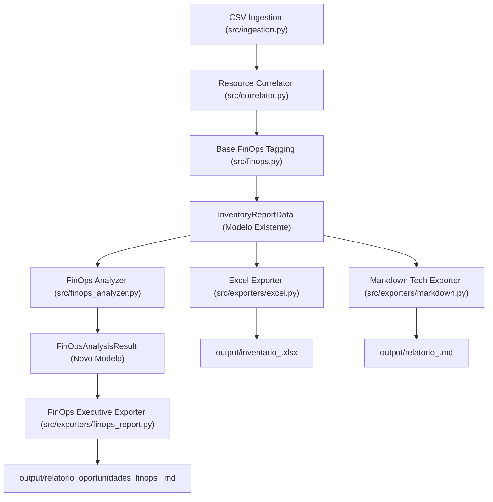

# Especificação de Design: Relatório Executivo de Oportunidades FinOps e Playbooks de Investigação

**Data:** 2026-11-09  
**Autor:** Antigravity & Time Técnico Multicanais  
**Ambiente Inicial:** `multicanais-dev` (Conta AWS `807445251352`)  
**Status:** Validado e Aprovado pelo Usuário  

---

## 1. Visão Geral e Contexto

No processo de auditoria de nuvem da conta AWS `multicanais-dev`, foi desenvolvido um pipeline inicial de inventário capaz de ingerir exportações CSV de serviços AWS, desduplicar recursos por ARN e mapear a topologia de aplicações.

No entanto, surgiu uma nova demanda estratégica de negócio intitulada **"Avaliar oportunidades de FinOps no ambiente AWS Multicanais"**, cujo objetivo específico é:
> *"Analisar padrões de consumo, recursos superdimensionados e serviços com potencial de redução de custos, propondo ações de otimização financeira."*

Para atender plenamente a essa demanda perante a liderança e partes interessadas, este projeto expande a ferramenta com um **módulo analítico dedicado de oportunidades FinOps** e um **gerador de relatório executivo independente** (`output/relatorio_oportunidades_finops_<conta>.md`).

Adicionalmente, considerando que os arquivos CSV de inventário estático da AWS não fornecem séries temporais completas de métricas de telemetria em tempo de execução (como porcentagem de uso de CPU/memória por hora, IOPS detalhadas ou contagem diária de requisições), a ferramenta **não descarta** recursos com dados incompletos. Em vez disso, classifica-os explicitamente como `[NECESSITA ANÁLISE]` e anexa um **Playbook Prático de Investigação**, fornecendo comandos prontos do **AWS CLI** e rotas no AWS Management Console para que a equipe possa auditar a telemetria com esforço mínimo.

---

## 2. Objetivos e Requisitos

### 2.1 Requisitos Funcionais
1. **Modelagem de Dados de Oportunidades FinOps:**
   - Criar estruturas formais em Python (`dataclasses`) para representar oportunidades (`FinOpsOpportunity`), guias de investigação com AWS CLI (`PlaybookGuide`) e o resultado analítico consolidado (`FinOpsAnalysisResult`).
2. **Motor Analítico Estratégico (`src/finops_analyzer.py`):**
   - Ingerir o `InventoryReportData` gerado pela etapa de correlação e inventário.
   - Analisar e categorizar os achados nos três pilares da demanda:
     - **Pilar A: Padrões de Consumo & Anomalias:** Avaliar dispersão em múltiplas regiões fora do escopo principal em ambiente de desenvolvimento, execução contínua 24x7 (potencial de agendamento automático) e serviços de custo fixo contínuo.
     - **Pilar B: Recursos Superdimensionados / Right-sizing:** Detectar desproporção arquitetural de balanceadores de carga (9 ALBs para 2 instâncias EC2) e indicar potenciais de redimensionamento para instâncias EC2 e bancos RDS.
     - **Pilar C: Serviços com Potencial de Redução de Custos:** Quantificar o impacto de consolidação de ALBs (economia estimada em USD/mês), liberação de Elastic IPs desassociados, limpeza de snapshots manuais antigos e eliminação de recursos de teste/temporários.
3. **Classificação Rigorosa de Evidência e Gaps:**
   - `[AÇÃO IMEDIATA]` (Evidência Conclusiva): Recursos cujo desperdício ou desproporção é comprovado diretamente no inventário.
   - `[NECESSITA ANÁLISE]` (Hipótese de Alto Potencial): Recursos com custo provisionado, mas cuja ação de desligamento/redimensionamento requer validação de telemetria (CloudWatch/Compute Optimizer).
4. **Playbooks de Investigação com Comandos AWS CLI Prontos:**
   - Para cada oportunidade com telemetria parcial, gerar instruções práticas com comandos AWS CLI preenchidos com os parâmetros reais da conta (região, IDs de instâncias, nomes de ALBs, namespaces de métricas).
5. **Novo Entregável Executivo (`src/exporters/finops_report.py`):**
   - Gerar `output/relatorio_oportunidades_finops_<conta>.md`, formatado com estética profissional para apresentação à liderança:
     - Scorecard consolidado de oportunidades.
     - Estimativas de economia financeira mensal e anual (em USD).
     - Matriz de Priorização (Esforço de Implementação x Impacto Financeiro: Quick Wins vs Projetos Estruturais).
     - Detalhamento por pilar.
     - Seção de Playbooks Práticos com blocos de código copiáveis.
     - Roadmap de Ação recomendado para 30, 60 e 90 dias.
6. **Integração Fluida no CLI (`src/main.py`):**
   - Executar automaticamente a análise de FinOps e a geração do relatório ao rodar o comando padrão `python -m src.main --input-dir ... --output-dir ...`.

### 2.2 Requisitos Não-Funcionais
- **Resiliência a Falhas:** Prevenir divisões por zero ou exceções ao processar contas que não possuam instâncias EC2, ALBs ou RDS.
- **Isolamento e Coesão:** Manter a lógica de inventário estático (`src/finops.py`) desacoplada do módulo analítico de oportunidades estratégicas (`src/finops_analyzer.py`).
- **Testabilidade:** Cobertura de 100% das novas regras e do gerador de Markdown via testes automatizados com `pytest`.

---

## 3. Arquitetura e Modelagem de Dados

### 3.1 Fluxo do Pipeline



### 3.2 Modelos de Dados (`src/models.py`)

Novas dataclasses adicionadas ao arquivo de modelos:

```python
from dataclasses import dataclass, field
from typing import List, Dict, Optional

@dataclass
class PlaybookGuide:
    playbook_id: str
    title: str
    target_metric: str
    target_resources: List[str]
    console_path: str
    aws_cli_command: str
    decision_criteria: str
    recommended_action: str

@dataclass
class FinOpsOpportunity:
    pillar: str  # "Padrões de Consumo", "Superdimensionamento", "Redução de Custos"
    title: str
    description: str
    evidence_status: str  # "[AÇÃO IMEDIATA]" ou "[NECESSITA ANÁLISE]"
    effort_level: str  # "Baixo (Quick Win)", "Médio", "Alto"
    impact_level: str  # "Alto", "Médio", "Baixo"
    estimated_monthly_savings_usd: Optional[float]
    affected_resources_count: int
    resource_identifiers: List[str]
    playbook_id: Optional[str] = None

@dataclass
class FinOpsAnalysisResult:
    account_id: str
    total_opportunities: int
    immediate_actions_count: int
    needs_analysis_count: int
    total_estimated_monthly_savings_usd: float
    pillar_consumption_opportunities: List[FinOpsOpportunity]
    pillar_rightsizing_opportunities: List[FinOpsOpportunity]
    pillar_cost_reduction_opportunities: List[FinOpsOpportunity]
    playbooks: List[PlaybookGuide]
```

---

## 4. Heurísticas Analíticas dos Três Pilares

### 4.1 Pilar A: Padrões de Consumo & Anomalias de Uso
1. **Dispersão Regional Inesperada em Dev:**
   - Detecta recursos em regiões secundárias (ex.: fora de `sa-east-1` e `ca-central-1`).
   - Se os recursos forem de serviços não essenciais, sugere centralização ou eliminação.
2. **Execução Contínua 24x7 em Ambiente Dev:**
   - Em ambiente dev, recursos de computação operam ~720 horas/mês.
   - Com regime útil (ex.: 08h às 19h em dias de semana = ~220 horas/mês), a economia potencial em EC2 e RDS atinge até **65%**.
   - Classificação: `[NECESSITA ANÁLISE]`, associado ao *Playbook 3 (Horários de Acesso e Agendamento)*.
3. **Serviços de Custo Fixo sem Escalar a Zero:**
   - Identifica componentes provisionados que geram custo constante mesmo sem uso (ALBs, clusters de cache).

### 4.2 Pilar B: Recursos Superdimensionados / Right-sizing
1. **Desproporção Arquitetural de ALBs vs Cargas de Computação:**
   - Avalia a métrica `ALBs / Instâncias EC2`. Na conta `multicanais-dev`, há 9 ALBs para 2 EC2s (razão de 4.5).
   - Oportunidade: Consolidar em 1 ou 2 ALBs compartilhados via path/host routing.
   - Classificação: `[AÇÃO IMEDIATA]` com economia direta estimada em ~$135 a ~$180/mês.
2. **Dimensionamento de Computação (EC2) e Bancos de Dados (RDS):**
   - Instâncias ativas identificadas no inventário são elegíveis para right-sizing.
   - Como os CSVs não contêm % de CPU ou memória, o sistema não descarta os recursos: classifica como `[NECESSITA ANÁLISE]` e aponta para o *Playbook 1 (EC2 Right-sizing & AWS Compute Optimizer)*.
3. **Modernização de Tipos de Armazenamento:**
   - Volumes e snapshots EBS identificados com tecnologia legada (`gp2`) recebem recomendação de migração para `gp3` (20% de economia imediata).

### 4.3 Pilar C: Serviços com Potencial de Redução de Custos
1. **Consolidação de ALBs:** Redução de 9 para 2 ALBs em dev = economia mínima de ~$157.50/mês (~$1.890/ano).
2. **Elastic IPs Desassociados:** Liberação de EIPs ociosos ($3.60/mês por IP).
3. **Snapshots e AMIs Antigos/Residuais:** Identificação de snapshots com idade > 60 dias para política de retenção.
4. **Recursos com Nomenclatura de Teste/Temporário:** Limpeza de itens como `snapshot-copy-test` e recursos `*teste*`.

---

## 5. Playbooks de Investigação com Comandos AWS CLI

Os cinco playbooks a seguir serão implementados no módulo analítico e impressos no relatório executivo com comandos parametrizados dinamicamente:

1. **Playbook 1: EC2 Right-sizing & Avaliação de Telemetria (CPU/Memória):**
   - Utiliza o **AWS Compute Optimizer** e métricas do CloudWatch:
     ```bash
     aws compute-optimizer get-ec2-instance-recommendations --region ca-central-1 --instance-arns <ARNs_das_instâncias>
     aws cloudwatch get-metric-statistics --region ca-central-1 --namespace AWS/EC2 --metric-name CPUUtilization --dimensions Name=InstanceId,Value=<InstanceId> --start-time 2026-10-01T00:00:00Z --end-time 2026-10-31T23:59:59Z --period 86400 --statistics Average Maximum
     ```
2. **Playbook 2: Auditoria de Tráfego e Inatividade dos ALBs:**
   - Verifica o volume real de requisições de cada ALB nos últimos 30 dias:
     ```bash
     aws cloudwatch get-metric-statistics --region ca-central-1 --namespace AWS/ApplicationELB --metric-name RequestCount --dimensions Name=LoadBalancer,Value=<LoadBalancerFullName> --start-time 2026-10-01T00:00:00Z --end-time 2026-10-31T23:59:59Z --period 86400 --statistics Sum
     ```
3. **Playbook 3: Conexões no Banco RDS e Viabilidade de Desligamento 24x7:**
   - Avalia métricas de `DatabaseConnections` fora do horário comercial:
     ```bash
     aws cloudwatch get-metric-statistics --region ca-central-1 --namespace AWS/RDS --metric-name DatabaseConnections --dimensions Name=DBInstanceIdentifier,Value=<DBIdentifier> --start-time 2026-10-01T00:00:00Z --end-time 2026-10-31T23:59:59Z --period 3600 --statistics Maximum
     ```
4. **Playbook 4: Auditoria de Snapshots Manuais Antigos e Volumes EBS Órfãos:**
   - Lista snapshots e volumes desassociados via AWS CLI.
5. **Playbook 5: Retenção e Ciclo de Vida de Log Groups no CloudWatch:**
   - Detecta grupos de log sem política de retenção configurada (`Never Expire`).

---

## 6. Estrutura do Relatório Executivo Markdown

O arquivo gerado em `output/relatorio_oportunidades_finops_<conta>.md` terá a seguinte estrutura:

- **1. Cabeçalho Executivo:** Conta, data, resumo da demanda e nota consultiva.
- **2. Scorecard Executivo & Impacto Financeiro:**
  - Tabela com Total de Oportunidades, Ações Imediatas, Hipóteses a Validar e Estimativa de Economia ($ USD/mês e $ USD/ano).
  - Matriz de Priorização (Esforço x Impacto: Quick Wins vs Projetos Estruturais).
- **3. Pilar A: Padrões de Consumo & Oportunidades de Agendamento (24x7).**
- **4. Pilar B: Recursos Superdimensionados & Right-sizing (ALBs, EC2, RDS).**
- **5. Pilar C: Serviços com Potencial de Redução Direta de Custos.**
- **6. Playbooks Práticos de Investigação (Guia Passo a Passo com Comandos AWS CLI).**
- **7. Roadmap Recomendado de Execução (30 / 60 / 90 dias).**

---

## 7. Estratégia de Testes Automatizados

1. **`tests/test_finops_analyzer.py`:**
   - Testar o cálculo correto de proporção ALB vs EC2 (inclusive quando `len(ec2) == 0`).
   - Testar detecção de dispersão regional em dev.
   - Testar correta segregação entre `[AÇÃO IMEDIATA]` e `[NECESSITA ANÁLISE]`.
   - Testar injeção dinâmica de parâmetros nos Playbooks do AWS CLI.
2. **`tests/test_finops_report_exporter.py`:**
   - Validar formatação do arquivo Markdown, presença de todas as seções e tabelas.
3. **Teste de Integração End-to-End:**
   - Rodar o pipeline completo apontando para `contas/multicanais-dev` e verificar a integridade dos 3 arquivos de saída em `output/`.
