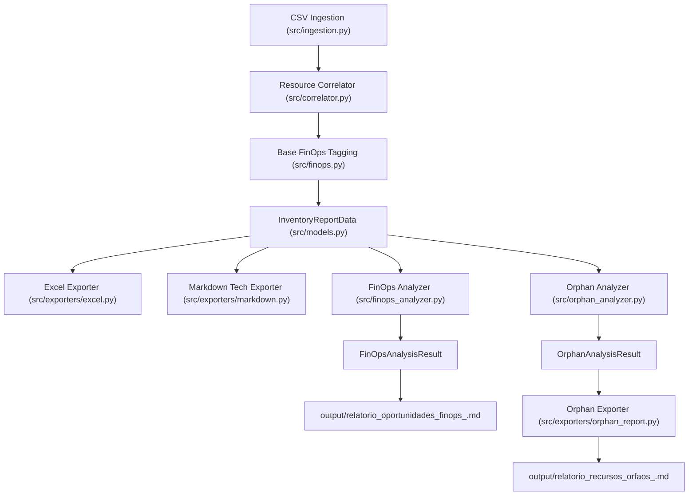

# Especificação de Design: Detector de Recursos Órfãos e Playbooks de Remediação Segura

**Data:** 2026-11-10  
**Autor:** Antigravity & Time Técnico Multicanais  
**Ambiente Inicial:** `multicanais-dev` (Conta AWS `807445251352`)  
**Status:** Validado e Aprovado pelo Usuário  

---

## 1. Visão Geral e Contexto

No processo de auditoria e governança de nuvem da conta AWS `multicanais-dev`, a ferramenta foi consolidada com capacidades de inventário desduplicado em Excel e Markdown técnico, além de um motor estratégico de **Oportunidades de FinOps** (`src/finops_analyzer.py` e `src/exporters/finops_report.py`).

Durante a evolução contínua da governança de custos e segurança, surgiu uma nova demanda essencial:
> *"Identificar recursos órfãos na conta AWS a partir dos inventários. Como os arquivos CSV estáticos exportados da AWS frequentemente não fornecem o status de anexo em tempo real (ex.: se um volume EBS ou EIP está desacoplado), o relatório deve classificar esses recursos de forma transparente e fornecer Playbooks Práticos com comandos do AWS CLI prontos para validação e descarte seguro."*

Para atender plenamente a esse requisito sem sobrecarregar os módulos existentes, esta especificação define a criação de um **subsistema analítico independente de detecção de recursos órfãos** (`src/orphan_analyzer.py`), um **gerador de relatório executivo dedicado** (`src/exporters/orphan_report.py`) e sua integração nativa no pipeline da CLI (`src/main.py`), culminando na geração automática de:
`output/relatorio_recursos_orfaos_<conta>.md`.

Adicionalmente, ao término da implementação, a documentação oficial do projeto no arquivo [README.md](file:///C:/Users/andre.luiz/Documents/resources%20multicanais-dev/README.md) será atualizada com uma seção detalhada descrevendo a nova funcionalidade.

---

## 2. Objetivos e Requisitos

### 2.1 Requisitos Funcionais
1. **Modelos de Dados Dedicados (`src/models.py`):**
   - Estruturas de dados formais para candidatos a recursos órfãos (`OrphanCandidate`), guias de playbooks práticos (`OrphanPlaybookGuide`) e o consolidado da auditoria da conta (`OrphanAnalysisResult`).
2. **Motor Analítico de Recursos Órfãos (`src/orphan_analyzer.py`):**
   - Ingerir o `InventoryReportData` gerado pela etapa de correlação de recursos.
   - Analisar o catálogo de recursos distribuídos nos 5 domínios prioritários:
     - **Armazenamento:** Volumes EBS desanexados (`status=available`), Snapshots manuais EBS e RDS sem retenção automática.
     - **Rede & Conectividade:** Elastic IPs sem associação (`NetworkInterfaceId == null`), Interfaces de Rede (ENIs) soltas (`status=available`) e Security Groups manuais sem vínculos.
     - **Balanceamento:** Application Load Balancers (ALBs) com zero requisições ou Target Groups com zero targets saudáveis.
     - **Cache & Dados In-Memory:** Usuários, ACLs e Parameter Groups de ElastiCache e MemoryDB sem clusters ativos na região.
     - **Segurança & Logs:** Certificados ACM não vinculados e Log Groups sem política de expiração ou órfãos de Lambdas removidas.
3. **Classificação Rigorosa de Evidência e Status:**
   - `[CONFIRMADO ÓRFÃO]`: Aplicado quando os próprios dados consolidados dos CSVs já provam a ausência de recurso pai (ex.: credenciais e ACLs de MemoryDB em regiões com zero clusters de cache provisionados).
   - `[CANDIDATO A ÓRFÃO]`: Aplicado quando o recurso foi catalogado no inventário estático, mas a prova cabal de desacoplamento depende de inspeção em tempo de execução via comando do AWS CLI fornecido.
4. **Estimativa de Desperdício Financeiro:**
   - Calcular valores em dólares (USD/mês e anualizado) para dar visibilidade executiva do impacto de custo dos itens ociosos (ex.: $3.65/mês por EIP solto, ~$8.00/mês por volume EBS médio, ~$22.50/mês por ALB ocioso).
5. **Playbooks Práticos de Duplo Estágio (Inspeção + Limpeza Segura):**
   - Cada grupo de achados conterá um guia com:
     - Rota de tela no Console da AWS.
     - Comando AWS CLI de inspeção/leitura (somente leitura com filtros e formatação JMESPath).
     - Critério de decisão para eliminação.
     - Alerta de segurança (*Guardrail*), recomendando backup/snapshot prévio.
     - Comando AWS CLI de remoção/liberação segura parametrizado com os identificadores reais.
6. **Novo Relatório Executivo e Técnico (`src/exporters/orphan_report.py`):**
   - Gerar `output/relatorio_recursos_orfaos_<conta>.md` com:
     - Scorecard executivo de desperdício mensal e anual.
     - Matriz de priorização (Quick Wins vs Projetos Estruturais vs Higienização Operacional).
     - Tabelas detalhadas por categoria com links diretos para os playbooks.
     - Seção de playbooks práticos com blocos em Bash prontos para cópia.
7. **Integração no CLI (`src/main.py`):**
   - Acionamento automático durante o comando padrão `python -m src.main --input-dir ... --output-dir ...`.
8. **Atualização da Documentação (`README.md`):**
   - Adicionar uma seção detalhada explicando a funcionalidade, os relatórios gerados e exemplos de uso.

### 2.2 Requisitos Não-Funcionais
- **Resiliência:** Tolerância a contas sem recursos órfãos, listas vazias ou tags nulas, sem lançamento de exceções não tratadas.
- **Desacoplamento Arquitetural:** Separação limpa entre a lógica de inventário (`src/correlator.py`), FinOps estratégico (`src/finops_analyzer.py`) e detecção de órfãos (`src/orphan_analyzer.py`).
- **Testabilidade:** Cobertura de 100% das novas classes, regras e geradores de relatório via `pytest`.

---

## 3. Arquitetura e Modelagem de Dados

### 3.1 Fluxo do Pipeline



### 3.2 Novas Classes de Modelo (`src/models.py`)

```python
from dataclasses import dataclass, field
from typing import List, Dict, Optional

@dataclass
class OrphanPlaybookGuide:
    playbook_id: str
    title: str
    category: str
    target_resources: List[str]
    inspection_console_path: str
    inspection_cli_command: str
    decision_criteria: str
    safe_cleanup_cli_command: str
    safety_recommendation: str

@dataclass
class OrphanCandidate:
    category: str
    resource_type: str
    resource_identifier: str
    resource_name: str
    region: str
    status: str                         # "[CONFIRMADO ÓRFÃO]" ou "[CANDIDATO A ÓRFÃO]"
    confidence_rationale: str
    estimated_monthly_waste_usd: float
    playbook_id: str

@dataclass
class OrphanAnalysisResult:
    account_id: str
    total_candidates: int
    confirmed_orphans_count: int
    potential_orphans_count: int
    total_estimated_monthly_waste_usd: float
    categories_breakdown: Dict[str, List[OrphanCandidate]]
    playbooks: List[OrphanPlaybookGuide]
```

---

## 4. Matriz de Detecção Analítica e Precificação

| Categoria | Tipos Auditados | Status Padrão | Regra / Lógica de Detecção | Custo Unitário Est. (USD/mês) |
| :--- | :--- | :--- | :--- | :--- |
| **Armazenamento** | `ec2:volume` | `[CANDIDATO A ÓRFÃO]` | O inventário de Resource Groups lista o volume, mas não o anexo (`attachment.status`). Deve-se validar se está `available`. | $8.00 / volume |
| **Armazenamento** | `ec2:snapshot` / `rds:snapshot` | `[CANDIDATO A ÓRFÃO]` | Snapshots manuais retidos sem ciclo de vida automático. | $2.50 (EBS) / $5.00 (RDS) |
| **Rede** | `ec2:elastic-ip` | `[CANDIDATO A ÓRFÃO]` | Elastic IPs alocados. Na AWS, EIPs desassociados são faturados continuamente ($0.005/h). | **$3.65 / EIP** |
| **Rede** | `ec2:network-interface` | `[CANDIDATO A ÓRFÃO]` | Interfaces ENI soltas (`status=available`) residuais de containers ou instâncias deletadas. | $0.00 (Higiene de IP) |
| **Rede** | `ec2:security-group` | `[CANDIDATO A ÓRFÃO]` | SGs manuais criados sem interfaces ativas associadas (ignora SG `default`). | $0.00 (Governança/VPC quota) |
| **Balanceamento** | `elasticloadbalancing:loadbalancer` | `[CANDIDATO A ÓRFÃO]` | Balanceadores de aplicação (ALBs) com zero requisições ou desproporcionais às instâncias da conta. | **$22.50 / ALB** |
| **Balanceamento** | `elasticloadbalancing:targetgroup` | `[CANDIDATO A ÓRFÃO]` | Target groups sem instâncias registradas ou desvinculados de listeners ativos. | $0.00 (Arquitetura) |
| **Cache & Dados** | `elasticache:user`, `memorydb:user`, `memorydb:acl`, `memorydb:parametergroup` | **`[CONFIRMADO ÓRFÃO]`** | **Evidência Conclusiva:** Itens de controle e usuários existentes em regiões onde a contagem de clusters ativos é zero. | $0.00 (Segurança e higiene) |
| **Segurança & Logs** | `acm:certificate` | `[CANDIDATO A ÓRFÃO]` | Certificados digitais emitidos sem associação direta a ALBs ou CloudFront. | $0.00 (Prevenção de expiração) |
| **Segurança & Logs** | `logs:log-group` | `[CANDIDATO A ÓRFÃO]` | Log groups de funções Lambda que não existem mais ou sem política de expiração. | $1.50 / log group |

---

## 5. Arquitetura dos Playbooks de Investigação e Descarte Seguro

Cada playbook é modelado para que o engenheiro de nuvem execute a validação imediata e proceda com a exclusão com máxima segurança:

1. **`pb-orphan-ebs-volumes`:**
   - **Inspeção:** `aws ec2 describe-volumes --region <reg> --filters Name=status,Values=available --query 'Volumes[*].{VolumeId:VolumeId,Size:Size,CreateTime:CreateTime}' --output table`
   - **Guardrail:** Criar snapshot prévio antes de deletar.
   - **Remoção:** `aws ec2 delete-volume --region <reg> --volume-id <vol-id>`
2. **`pb-orphan-elastic-ips`:**
   - **Inspeção:** `aws ec2 describe-addresses --region <reg> --query 'Addresses[?NetworkInterfaceId==null].{AllocationId:AllocationId,PublicIp:PublicIp}' --output table`
   - **Guardrail:** Checar se o IP público consta em registros DNS externos.
   - **Remoção:** `aws ec2 release-address --region <reg> --allocation-id <alloc-id>`
3. **`pb-orphan-enis`:**
   - **Inspeção:** `aws ec2 describe-network-interfaces --region <reg> --filters Name=status,Values=available --output table`
   - **Remoção:** `aws ec2 delete-network-interface --region <reg> --network-interface-id <eni-id>`
4. **`pb-orphan-security-groups`:**
   - **Inspeção:** Query para listar SGs com zero interfaces ativas acopladas.
   - **Guardrail:** Não excluir o SG `default`.
   - **Remoção:** `aws ec2 delete-security-group --region <reg> --group-id <sg-id>`
5. **`pb-orphan-albs-targetgroups`:**
   - **Inspeção:** `aws elbv2 describe-target-health --region <reg> --target-group-arn <tg-arn>`
   - **Remoção:** `aws elbv2 delete-load-balancer ...` e `aws elbv2 delete-target-group ...`
6. **`pb-orphan-cache-users`:**
   - **Inspeção:** Validar ausência de clusters ativos.
   - **Remoção:** `aws memorydb delete-user ...` e `aws memorydb delete-acl ...`
7. **`pb-orphan-snapshots`:**
   - **Inspeção:** `aws ec2 describe-snapshots --region <reg> --owner-ids self ...`
   - **Remoção:** `aws ec2 delete-snapshot --region <reg> --snapshot-id <snap-id>`

---

## 6. Estrutura do Relatório Markdown (`relatorio_recursos_orfaos_<conta>.md`)

O documento final exportado seguirá a seguinte hierarquia visual e técnica:
1. **Título Executivo e Aviso Consultivo:** Contexto da conta e advertência de que remoções de infraestrutura devem ser aprovadas pela equipe responsável.
2. **Scorecard Executivo de Recursos Órfãos:** Tabela resumida com Total de Recursos Auditados, Confirmados Órfãos, Candidatos a Órfão, Desperdício Mensal Projetado e Desperdício Anualizado.
3. **Matriz de Priorização (Esforço x Impacto):**
   - Quick Wins (Alto Impacto / Baixo Esforço): EIPs e volumes disponíveis.
   - Projetos Estruturais (Alto Impacto / Médio Esforço): Consolidação de ALBs ociosos.
   - Higienização Operacional: Exclusão de ENIs, SGs e credenciais de cache residuais.
4. **Tabelas de Achados por Domínio:** Detalhamento por categoria contendo links internos (`#pb-...`) para os playbooks correspondentes.
5. **Playbooks Práticos:** Blocos de instruções e códigos Bash formatados para cópia rápida com substituição de variáveis reais da conta.

---

## 7. Estratégia de Testes Automatizados

- `tests/test_orphan_analyzer.py`:
  - Testar detecção de volumes EBS como candidatos a órfão e validação do cálculo financeiro.
  - Testar detecção de Elastic IPs soltos com impacto fixo ($3.65/mês por IP).
  - Testar confirmação estrita (`[CONFIRMADO ÓRFÃO]`) para credenciais de cache sem cluster na região.
  - Testar balanceadores e target groups vazios.
  - Testar resiliência com inventário sem nenhum recurso órfão (cenário limpo).
- `tests/test_orphan_report_exporter.py`:
  - Validar a escrita correta do arquivo markdown e criação de diretórios.
  - Verificar renderização do Scorecard, tabelas por categoria e blocos de código Bash dos playbooks.
- `tests/test_e2e.py`:
  - Validar o pipeline completo em `src/main.py`, confirmando a criação simultânea de todos os 4 relatórios (`.xlsx`, `relatorio_<conta>.md`, `relatorio_oportunidades_finops_<conta>.md` e `relatorio_recursos_orfaos_<conta>.md`).

---

## 8. Atualização da Documentação (`README.md`)

O arquivo [README.md](file:///C:/Users/andre.luiz/Documents/resources%20multicanais-dev/README.md) será atualizado na conclusão da implementação para:
- Incluir a descrição do 4º entregável no resumo do projeto.
- Detalhar os 5 domínios de auditoria de recursos órfãos.
- Explicar a convenção de status (`[CONFIRMADO ÓRFÃO]` vs `[CANDIDATO A ÓRFÃO]`).
- Documentar os playbooks de inspeção e limpeza segura gerados pela CLI.
