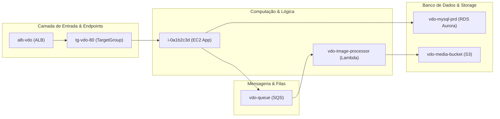

# Especificação de Design: Mapeamento de Arquitetura de Aplicações, Topologia de Dependências e Governança (Ownership)

**Data:** 2026-11-11  
**Autor:** Antigravity & Time Técnico Multicanais  
**Ambiente Inicial:** Contas AWS Multicanais (ex: `multicanais-dev` - `807445251352`)  
**Status:** Validado e Aprovado pelo Usuário  

---

## 1. Visão Geral e Contexto

A solução de governança e inventário multicanais consolidou com sucesso o inventário desduplicado de recursos em Excel, relatórios técnicos em Markdown e DOCX, o analisador de oportunidades FinOps (`src/finops_analyzer.py`) e o detector de recursos órfãos com playbooks de remediação (`src/orphan_analyzer.py`).

Com a infraestrutura catalogada e os custos auditados, surgiu uma nova necessidade arquitetural estratégica:
> *"Identificar aplicações, integrações, endpoints, filas, bancos e demais componentes que sustentam o uso atual do ambiente, registrando dependências e responsáveis (ownership). Implementar essa funcionalidade na aplicação gerando relatórios completos nos moldes dos anteriores (Markdown com diagramas Mermaid, DOCX corporativo e aba no Excel do inventário), inferindo o máximo possível a partir dos CSVs estáticos e permitindo enriquecimento declarativo via catálogo."*

Esta especificação formaliza a criação do **Subsistema de Topologia Arquitetural e Governança de Aplicações**, composto por:
1. Novos modelos de dados tipados em `src/models.py`.
2. Um motor analítico e de inferência de dependências em `src/topology_analyzer.py`.
3. Um gerador de relatório executivo e técnico em Markdown com diagramas Mermaid em `src/exporters/topology_report.py`.
4. Uma nova aba dedicada `"Topologia & Arquitetura"` no gerador de planilhas `src/exporters/excel.py`.
5. Conversão automática para Word (.docx) na pasta `output/docs/`.
6. Integração transparente no pipeline principal (`src/main.py`) e documentação oficial no `README.md`.

---

## 2. Objetivos e Requisitos

### 2.1 Requisitos Funcionais

1. **Modelos de Dados Dedicados (`src/models.py`):**
   - `TopologyComponent`: Representação canônica de cada elemento (id, nome amigável, serviço, camada arquitetural, arn, região, squad, owner, criticidade, upstream_ids, downstream_ids).
   - `ComponentConnection`: Representação de arestas de integração orientadas (origem, destino, tipo de conexão, rótulo descritivo).
   - `ApplicationTopology`: Estrutura agregadora por aplicação com coleções de componentes agrupados por camada e lista de conexões internas e externas.
   - `TopologyAnalysisResult`: Estrutura consolidada da conta (métricas executivas, distribuições por camada e squad, aplicações mapeadas, componentes compartilhados e itens pendentes de atribuição).

2. **Catálogo Declarativo de Governança (`applications.json` / `catalog/applications.json`):**
   - Esquema JSON simples para cadastrar squads, responsáveis (tech leads / owners), criticidade (Tier 1 a 3) e regras de correspondência (*match patterns*).
   - Suporte a fallback gracioso: caso o catálogo não exista ou um recurso não esteja mapeado, o motor utiliza tags do CSV e heurísticas por nomenclatura sem interromper o processamento.

3. **Motor Analítico de Topologia (`src/topology_analyzer.py`):**
   - **Classificação em 5 Camadas Funcionais:**
     - *Ingresso & Endpoints:* Application Load Balancers, Network Load Balancers, API Gateways, CloudFront, Route53.
     - *Computação & Microsserviços:* Instâncias EC2, Funções Lambda, Serviços/Tarefas ECS, Elastic Beanstalk.
     - *Mensageria & Filas:* Filas SQS, Tópicos SNS, Barramentos/Regras EventBridge.
     - *Banco de Dados & Cache:* Instâncias/Clusters RDS Aurora/Postgres/MySQL, DynamoDB, ElastiCache, MemoryDB, DocumentDB.
     - *Armazenamento & Apoio:* Buckets S3, Segredos no Secrets Manager, EFS.
   - **Resolução de Responsáveis (Ownership):**
     - Prioridade 1: Regras do Catálogo Declarativo (`match_patterns`).
     - Prioridade 2: Tags presentes no CSV (`Owner`, `Squad`, `Team`, `Responsavel`, `Criticidade`).
     - Prioridade 3: Slug de aplicação inferido por nomenclatura de cluster.
     - Fallback: Governança -> `"Squad Segurança & Governança"`; Infra compartilhada -> `"Squad Infraestrutura Cloud"`; Demais -> `"Squad A Definir"`.
   - **Motor de Inferência de Conexões e Dependências:**
     - *Ingresso:* Mapeamento de `ALB` para `Target Group` e deste para nós de computação (`EC2`/`ECS`/`Lambda`).
     - *Gatilhos de Eventos:* Mapeamento de tópicos `SNS` e filas `SQS` disparando ou consumidos por `Lambdas` correlacionadas por domínio.
     - *Persistência & Dados:* Conexão entre nós de computação da aplicação e seus respectivos bancos de dados (`RDS`, `DynamoDB`, `MemoryDB`) e buckets `S3`.
     - *Segredos:* Vínculo com segredos no `Secrets Manager` pelo padrão de nomenclatura da aplicação.
     - *Nós Compartilhados:* Sinalização de componentes utilizados por múltiplos clusters de aplicação.

4. **Relatório Executivo e Técnico em Markdown (`src/exporters/topology_report.py`):**
   - Gera `output/markdowns/relatorio_arquitetura_aplicacoes_<conta>.md`.
   - Scorecard executivo com métricas de componentes, camadas e índice de cobertura de governança.
   - Matriz consolidada de Governança (Aplicação, Squad, Owner, Criticidade, Qtd Componentes, Endpoints).
   - Para cada aplicação:
     - Cartão informativo com descrição, responsável e criticidade.
     - **Diagrama Mermaid (`flowchart LR`)** estruturado com subgrafos por camada funcional demonstrando o fluxo visual ponta a ponta.
     - Tabela de componentes com colunas de Upstream e Downstream.
     - Matriz de integrações e interfaces externas.
   - Seção dedicada a Infraestrutura Compartilhada e Gaps de Governança (recursos a classificar).

5. **Aba no Excel do Inventário (`src/exporters/excel.py`):**
   - Criação da aba `"Topologia & Arquitetura"` em `output/spreadsheets/inventario_<conta>.xlsx`.
   - Colunas completas: Aplicação, Squad Responsável, Tech Lead/Owner, Criticidade, ID do Componente, Nome Amigável, Serviço AWS, Camada Funcional, Região, Origem (Upstream), Destino (Downstream), ARN.
   - Formatação consistente com estilo institucional já aplicado nas demais abas.

6. **Conversão para Word Corporativo (`src/exporters/docx_report.py`):**
   - Geração automática de `output/docs/relatorio_arquitetura_aplicacoes_<conta>.docx`.
   - Renderização limpa e corporativa das tabelas e blocos de integração.

7. **Pipeline CLI (`src/main.py`):**
   - Execução automatizada e inclusão do argumento opcional `--catalog`.

### 2.2 Requisitos Não-Funcionais

- **Idempotência e Performance:** Processamento em memória a partir de `InventoryReportData`, com tempo de execução inferior a 3 segundos para inventários com mais de 1.000 recursos.
- **Resiliência e Higienização:** Nomes e nós do Mermaid obrigatoriamente sanitizados para evitar erros de sintaxe (como caracteres especiais em ARNs ou identificadores).
- **Compatibilidade Retroativa:** Preservação de todos os 74 testes automatizados existentes.

---

## 3. Arquitetura e Modelagem de Dados

### 3.1 Novos Modelos em `src/models.py`

```python
from dataclasses import dataclass, field
from typing import List, Dict, Optional

@dataclass
class TopologyComponent:
    id: str
    name: str
    service: str
    layer: str  # "Ingresso & Endpoints", "Computação & Lógica", "Mensageria & Filas", "Banco de Dados & Cache", "Armazenamento & Apoio"
    arn: str
    region: str
    squad: str
    owner: Optional[str] = None
    criticality: str = "Padrão"
    upstream_ids: List[str] = field(default_factory=list)
    downstream_ids: List[str] = field(default_factory=list)

@dataclass
class ComponentConnection:
    source_id: str
    target_id: str
    connection_type: str  # "Ingress", "EventTrigger", "DataAccess", "DomainCluster"
    label: str

@dataclass
class ApplicationTopology:
    app_name: str
    slug: str
    squad: str
    owner: Optional[str]
    criticality: str
    description: str
    components: List[TopologyComponent] = field(default_factory=list)
    connections: List[ComponentConnection] = field(default_factory=list)

    @property
    def ingress_components(self) -> List[TopologyComponent]:
        return [c for c in self.components if c.layer == "Ingresso & Endpoints"]

    @property
    def compute_components(self) -> List[TopologyComponent]:
        return [c for c in self.components if c.layer == "Computação & Lógica"]

    @property
    def messaging_components(self) -> List[TopologyComponent]:
        return [c for c in self.components if c.layer == "Mensageria & Filas"]

    @property
    def database_components(self) -> List[TopologyComponent]:
        return [c for c in self.components if c.layer == "Banco de Dados & Cache"]

    @property
    def storage_components(self) -> List[TopologyComponent]:
        return [c for c in self.components if c.layer == "Armazenamento & Apoio"]

@dataclass
class TopologyAnalysisResult:
    account_id: str
    total_applications: int
    total_components: int
    total_connections: int
    assigned_squads_count: int
    squad_distribution: Dict[str, int]
    layer_distribution: Dict[str, int]
    applications: List[ApplicationTopology]
    shared_infrastructure: List[TopologyComponent]
    unassigned_components: List[TopologyComponent]
    account_name: Optional[str] = None
    account_display: Optional[str] = None

    @property
    def display_title(self) -> str:
        if self.account_display:
            return self.account_display
        if self.account_name and self.account_name != self.account_id:
            return f"Conta {self.account_name} ({self.account_id})"
        return f"Conta {self.account_id}"
```

---

## 4. Catálogo Declarativo de Aplicações e Governança

Estrutura do arquivo `applications.json` (ou `catalog/applications.json`):

```json
{
  "applications": {
    "canais-digitais": {
      "name": "Canais Digitais",
      "squad": "Squad Canais & Portais",
      "owner": "techlead-canais@empresa.com",
      "criticality": "Crítica / Tier 1",
      "match_patterns": ["canais", "multicanais", "canaisdb"],
      "description": "Plataforma central de atendimento e portais digitais"
    },
    "vdo-promocao": {
      "name": "VDO & Promoção Digital",
      "squad": "Squad Marketing & Promoções",
      "owner": "techlead-vdo@empresa.com",
      "criticality": "Alta",
      "match_patterns": ["vdo", "promo-digital", "promodb", "alb-vdo", "porto-vdo"],
      "description": "Sistema de gestão e veiculação de promoções e campanhas"
    },
    "wordpress-blog": {
      "name": "WordPress / Blog",
      "squad": "Squad Conteúdo & Institucional",
      "owner": "techlead-conteudo@empresa.com",
      "criticality": "Média",
      "match_patterns": ["wordpress", "blog"],
      "description": "Portais de conteúdo corporativo e blogs institucionais"
    }
  }
}
```

---

## 5. Motor Analítico de Topologia (`src/topology_analyzer.py`)

### 5.1 Regras de Mapeamento de Camadas

| Camada | Critérios de Associação (Serviço AWS / CFN / Tipo) |
|---|---|
| **Ingresso & Endpoints** | `elasticloadbalancing`, `alb`, `nlb`, `loadbalancer`, `targetgroup`, `apigateway`, `cloudfront`, `route53` |
| **Computação & Lógica** | `ec2` (instância), `lambda` (função), `ecs` (service/task), `elasticbeanstalk` |
| **Mensageria & Filas** | `sqs` (queue), `sns` (topic), `events` / `eventbridge` |
| **Banco de Dados & Cache** | `rds` (db instance, cluster), `dynamodb` (table), `elasticache`, `memorydb`, `docdb` |
| **Armazenamento & Apoio** | `s3` (bucket), `secretsmanager` (secret), `efs` |

### 5.2 Resolução de Squad e Ownership

1. Se houver correspondência de qualquer `match_pattern` da aplicação definida no catálogo com `identifier`, `arn` ou tags $\rightarrow$ atribui a Squad, Owner e Criticidade do catálogo.
2. Caso contrário, busca tags nativas no CSV: `Owner`, `Squad`, `Team`, `Responsavel`, `Criticidade`.
3. Caso pertença a um cluster conhecido em `correlator.py` mas não haja catálogo $\rightarrow$ atribui `"Squad <Nome da Aplicação>"`.
4. Fallback padrão:
   - Se `macro_domain == "Governança"` $\rightarrow$ `"Squad Segurança & Governança"`.
   - Se infraestrutura compartilhada $\rightarrow$ `"Squad Infraestrutura Cloud"`.
   - Demais $\rightarrow$ `"Squad A Definir"`.

### 5.3 Inferência de Conexões e Grafo

- **Ingresso:** Para cada Load Balancer de uma aplicação, cria conexão com os Target Groups da mesma aplicação e destes para instâncias EC2 / ECS.
- **Mensageria:** Conecta filas SQS e tópicos SNS às funções Lambda que contenham o mesmo slug de aplicação ou prefixo comum.
- **Persistência:** Conecta instâncias EC2 e funções Lambda aos bancos de dados (`RDS`, `MemoryDB`, `ElastiCache`) e buckets `S3` que compartilham a mesma aplicação/slug.
- **Segredos:** Conecta os nós de computação da aplicação aos segredos correspondentes no `Secrets Manager`.

---

## 6. Exportadores e Relatórios

### 6.1 Relatório Markdown com Diagramas Mermaid (`src/exporters/topology_report.py`)

Gera `output/markdowns/relatorio_arquitetura_aplicacoes_<conta>.md`.

Exemplo de bloco Mermaid gerado dinamicamente para uma aplicação:



### 6.2 Relatório Word (.docx) (`src/exporters/docx_report.py`)

A função existente `convert_markdown_to_docx` processa o arquivo Markdown recém-gerado, produzindo `output/docs/relatorio_arquitetura_aplicacoes_<conta>.docx` formatado no padrão corporativo.

### 6.3 Aba no Excel do Inventário (`src/exporters/excel.py`)

Adiciona a aba `"Topologia & Arquitetura"` contendo todas as 12 colunas operacionais, auto-filtro e formatação de células zebrada com cabeçalho institucional.

---

## 7. Integração no Pipeline CLI (`src/main.py`)

Argumento adicionado ao `argparse`:
`--catalog`: Caminho customizado para o arquivo de catálogo de aplicações (opcional).

Etapas no método `run_pipeline`:
1. Resolução de conta e leitura de inventário.
2. Correlação e regras FinOps.
3. Geração de relatórios FinOps e Recursos Órfãos.
4. **Execução de `analyze_application_topology`**:
   - Geração de `relatorio_arquitetura_aplicacoes_<conta>.md`.
   - Adição da aba de topologia no `inventario_<conta>.xlsx`.
   - Conversão para `relatorio_arquitetura_aplicacoes_<conta>.docx`.

---

## 8. Estratégia de Testes

1. **`tests/test_topology_analyzer.py`:**
   - Validação da correta categorização nas 5 camadas.
   - Resolução de ownership por catálogo, tags e fallbacks.
   - Inferência precisa de conexões entre endpoints, computação, mensageria e bancos.
   - Casos com catálogo ausente e dados mínimos.
2. **`tests/test_topology_report_exporter.py`:**
   - Validação de conteúdo Markdown, tabelas e sintaxe válida dos diagramas Mermaid.
3. **`tests/test_excel_exporter.py`:**
   - Verificação da aba `"Topologia & Arquitetura"` no Excel gerado.
4. **`tests/test_e2e.py`:**
   - Execução do pipeline completo gerando com sucesso os 5 artefatos esperados.
   - Garantia de 100% de passagem de toda a suíte.

---

## 9. Atualização da Documentação (`README.md`)

O `README.md` será expandido com:
- Seção "Topologia de Arquitetura e Governança de Aplicações".
- Exemplo de diagrama Mermaid renderizado.
- Especificação de como configurar o arquivo `applications.json`.
- Tabela explicativa de cada um dos artefatos gerados.
